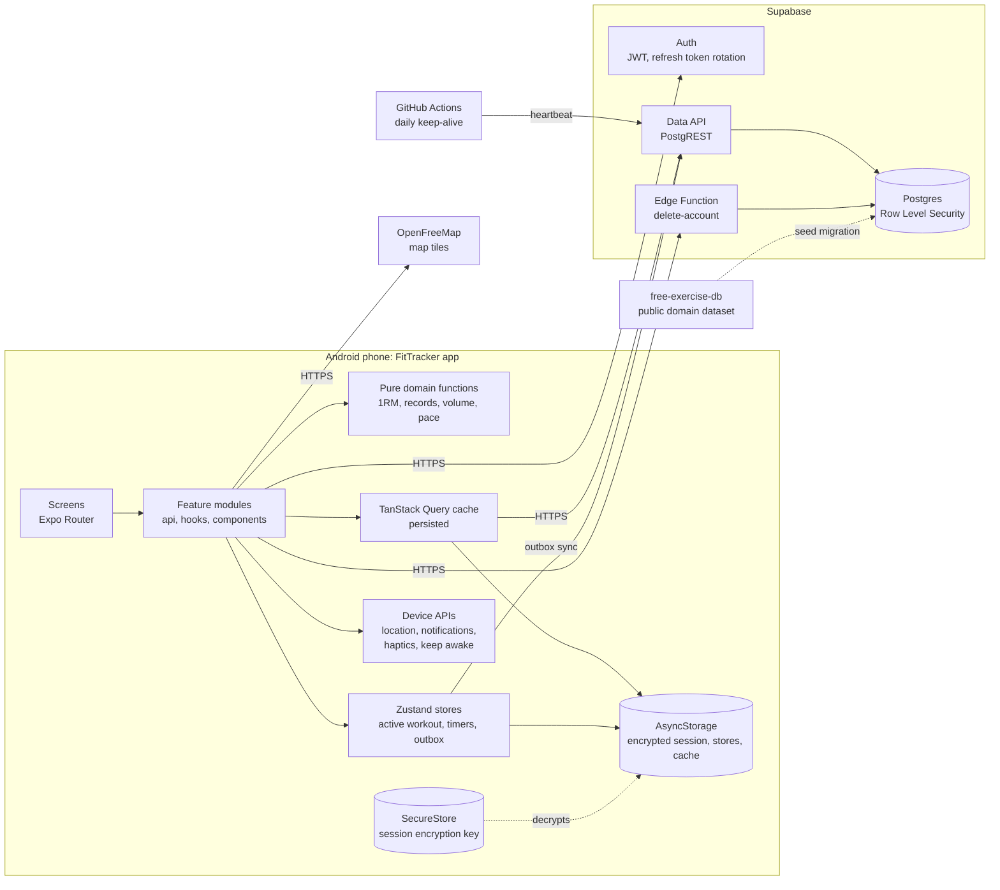

# System architecture

How the app on the phone connects to Supabase and the few external services it uses. Dotted lines happen once or indirectly: the exercise dataset is turned into a migration at build time, and the SecureStore key only decrypts what AsyncStorage holds.

