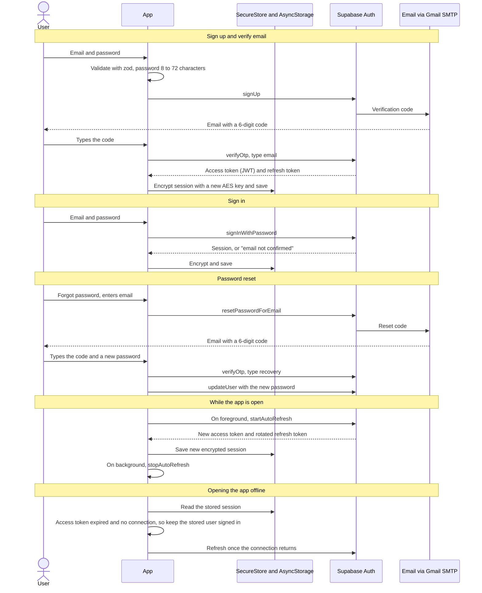

# Authentication flow

Sign-up with email verification, sign-in, password reset, and how the session is kept fresh. Verification and reset use 6-digit codes typed into the app, so they work even when the email is opened on another device. Emails go through custom SMTP because Supabase's built-in sender only delivers to project team members.

