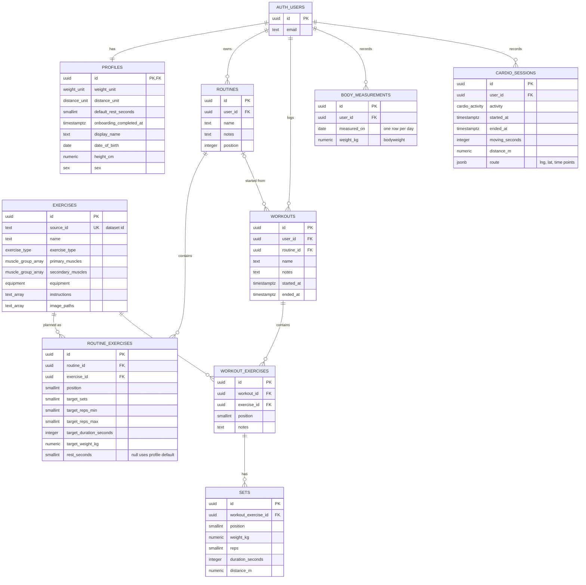

# Entity relationship diagram

The tables as they stand after every migration in `supabase/migrations/` (the initial schema, the profile details, and the later removals of unused tables and columns). Every table except `profiles` and `exercises` also has a `user_id` column referencing `auth.users`. Those links are left out below to keep the diagram readable; Row Level Security uses them to restrict each row to its owner.

