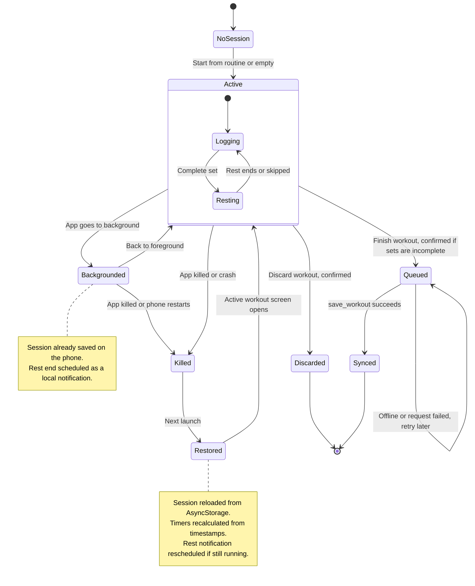

# Active workout lifecycle

How a workout in progress survives the app going to the background, being killed, or the phone restarting, and how it reaches the server. The session is stored on the phone after every change, and all timers are calculated from stored timestamps.

While a workout is queued, it shows "Not synced yet". The queue is retried when the connection returns and when the app comes to the foreground. Because the workout's ID was created on the phone, a retry after a lost response cannot create a duplicate.
